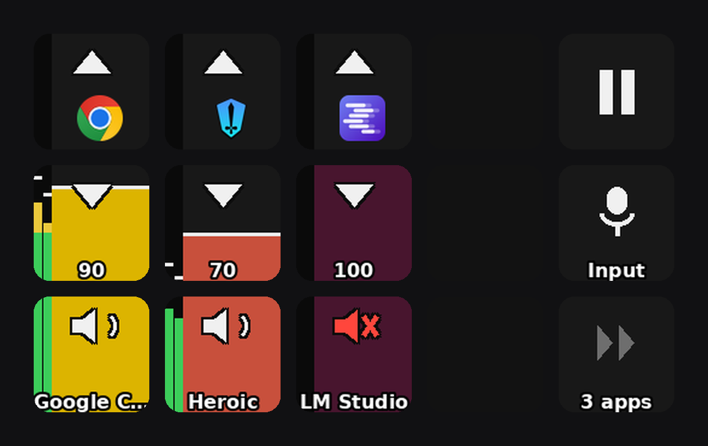
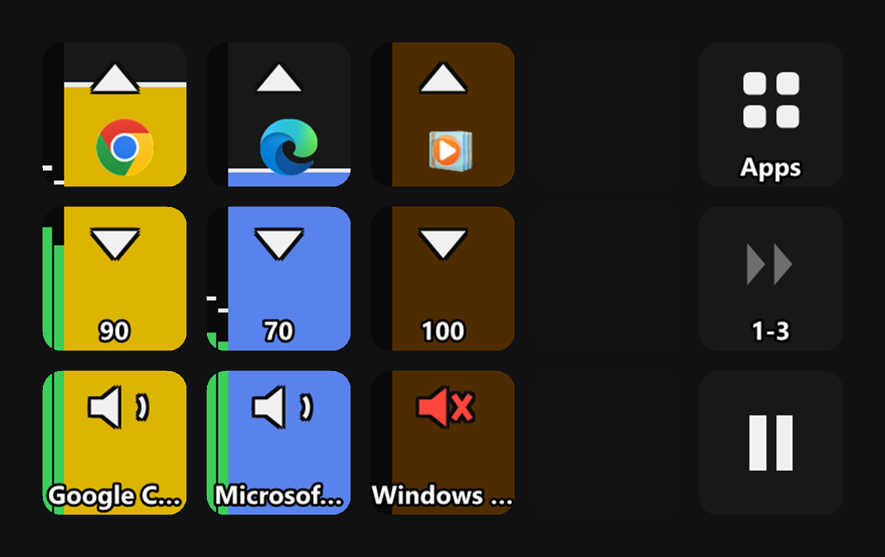

# Stream Deck audio mixer

A Stream Deck MK.2 as a software audio mixer: colored multi-key fader columns with
volume up/down/mute keys, live stereo VU meters with peak-hold, and a media-transport key.

| Platform | Implementation | Pages |
|---|---|---|
| [Linux](linux/README.md) | PipeWire virtual channels + a [StreamController](https://github.com/StreamController/StreamController) plugin (Python) | Apps, Channels, Outputs, Inputs |
| [Windows](windows/README.md) | a plugin for Elgato's Stream Deck app (C#, Core Audio) | Apps, Outputs, Inputs |

The two share the look, layout, color palette and config ideas, but no code. Each is
written against its platform's audio stack.

## License

[MIT](LICENSE).
