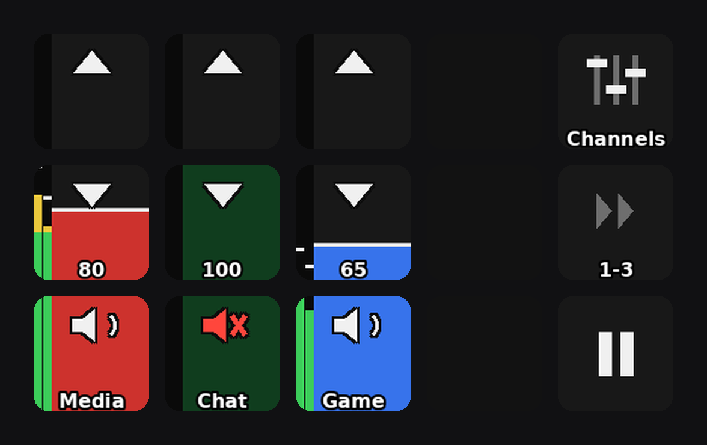
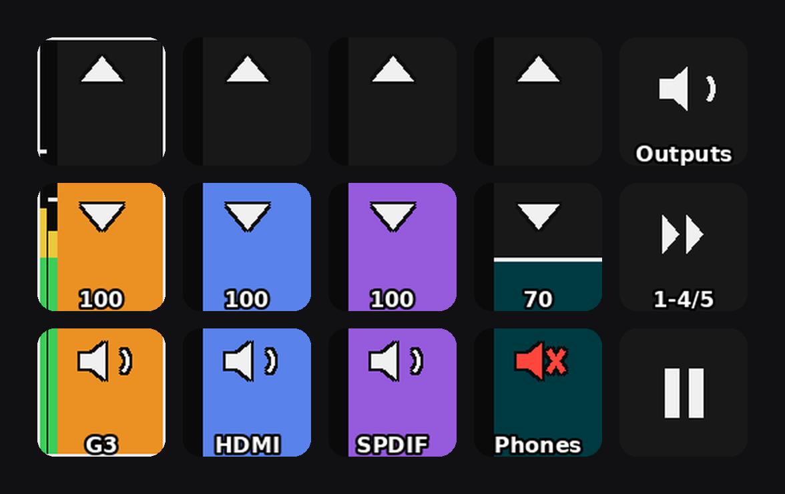
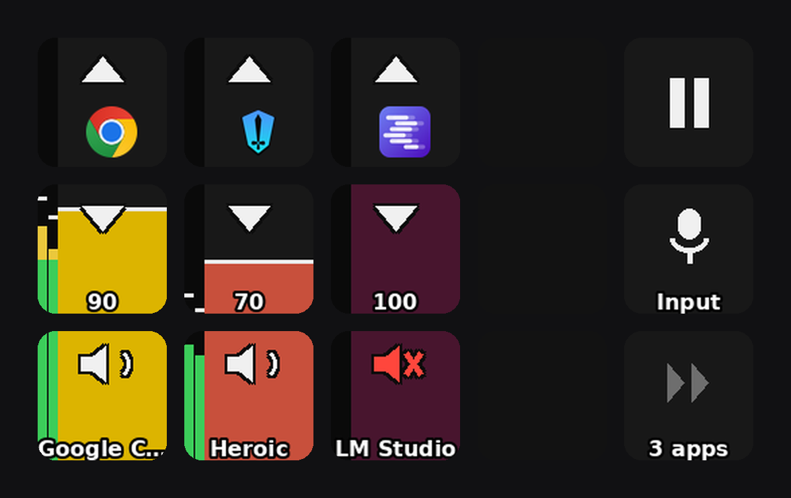
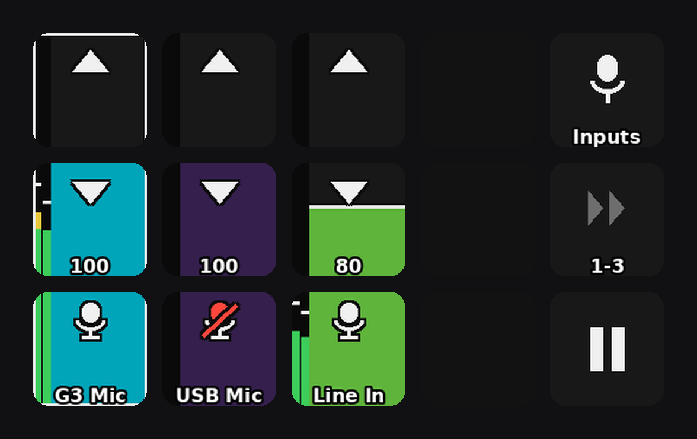

# Software mixer: PipeWire virtual channels + Stream Deck control surface

A software replacement for a Roland Bridge Cast: multiple virtual audio channels
("Media", "Chat", "Game") that mix into a physical output (Sound Blaster G3), with a
Stream Deck MK.2 as the physical control surface — colored per-channel fader columns
with volume up/down/mute keys, live stereo VU meters with peak-hold, 150% overdrive,
and MPRIS media-transport keys.

Built on Pop!_OS with PipeWire 1.6.8 / WirePlumber 0.5.12 and
[StreamController](https://github.com/StreamController/StreamController) 1.5.0-beta.16.









*(Four pages — Channels: music on Media, Chat muted; Outputs: the default device ringed
and metered, Phones muted; Apps: per-application faders with icons; Inputs: USB Mic
muted. All rendered by the actual plugin code via `docs/render_preview.py`.)*

> This is my personal setup, published as-is in case it's useful — the sink names, deck
> serial, colors and layout are mine (see [Hardware assumptions](#hardware-assumptions-edit-if-they-change)),
> but every piece is plain config/Python and straightforward to adapt. The
> [gotchas section](#hard-won-gotchas-read-before-debugging) alone may save you hours
> if you're building anything similar.

## Architecture

```
apps (Steam, Spotify, Discord, ...)
  │  each app routed once via pavucontrol / GNOME sound settings;
  │  WirePlumber remembers the choice per application
  ▼
virtual sinks: media_channel / chat_channel / game_channel   (PipeWire loopbacks)
  │  per-channel volume = channel fader
  ▼
Sound Blaster G3 sink = master fader
```

The Stream Deck drives the sink volumes through StreamController with a single custom
plugin, **FaderDisplay** (in this repo) — each column of three keys is one continuous
vertical fader (bottom key 0–50%, middle 50–100%, top 100–150%), filled in the channel
color, dimmed to 35% brightness when muted, with chevron/mute glyphs and per-row text.
Everything is **discovered at runtime** across four pages — **Apps** (whatever is
playing audio right now; the boot page), **Channels** (any sink named `*_channel`),
**Outputs** (every output device, the default listed first with an accent ring) and
**Inputs** (non-monitor sources: microphones and line-ins, default first) — so the page
JSON never needs editing when channels, devices or apps change. One utility key cycles
the pages.

## Repo layout

| Path | Installs to |
|---|---|
| `pipewire/10-virtual-channels.conf` | `~/.config/pipewire/pipewire.conf.d/` |
| `streamcontroller/pages/*.json` (Apps/Channels/Outputs/Inputs) | `~/.var/app/com.core447.StreamController/data/pages/` |
| `streamcontroller/settings/pages.json` | `~/.var/app/com.core447.StreamController/data/settings/` (maps deck serial → default page) |
| `streamcontroller/settings/fader-display.json` | same place (optional: channel order/labels/colors; delete it for automatic) |
| `streamcontroller/plugins/com_marc_FaderDisplay/` | `~/.var/app/com.core447.StreamController/data/plugins/` |

## Restore from scratch

```bash
./restore.sh
```

Then one manual step: route each app to its channel once in `pavucontrol` (Playback
tab) — WirePlumber remembers it from then on.

### Hardware assumptions (edit if they change)

- **G3 sink name** (only in the PipeWire conf — the deck pages discover everything):
  `alsa_output.usb-Creative_Technology_Ltd_Sound_Blaster_G3_CC08F2F2C2F3E386-03.analog-stereo`
  — if the G3 is replaced, get the new name from `pactl list sinks short` and
  search/replace in `pipewire/10-virtual-channels.conf`.
- **Deck serial** `A00SA5182J7QBL` in `settings/pages.json` — a different deck needs
  its serial swapped in (shown in StreamController, or in its log on connect).
- No udev rule is needed for the Stream Deck: modern systemd ships uaccess rules for
  Elgato decks out of the box.

## How the pieces work

### PipeWire virtual channels

Each channel is a `libpipewire-module-loopback`: the capture side is a virtual sink
(`media_channel` etc.), the playback side is pinned to the G3 by `target.object`.
Because it's a user config fragment, it loads at every login — no service, no script.
Deliberate choices, commented in the conf:

- `node.dont-reconnect = true`: if the G3 is unplugged, channels go silent instead of
  failing over to another output (avoids misrouting and feedback loops).
- `node.passive = true`: channels suspend when idle.
- Adding a channel = copy a block, rename `node.description` + both `node.name`s, then
  `systemctl --user restart pipewire pipewire-pulse wireplumber`.

### Channels and Outputs pages

Fader rows top→bottom: **+10% (▲) / −10% (▼, shows volume) / mute (speaker, shows name)**.

The **Channels** page gives every sink named `*_channel` a fader column (virtual
streams only). The **Outputs** page lists every *other* sink — the physical and
virtual output devices — with the current **default device first**, drawn with a white
accent ring and carrying the live meter; it follows default-device changes live.
Both pages get a pager key beyond four columns. Order, labels and colors come from the
optional config file
`~/.var/app/com.core447.StreamController/data/settings/fader-display.json`:

```json
{
  "channels": [
    {"match": "media_channel", "color": [205, 50, 45]},
    {"match": "chat_channel",  "color": [45, 175, 85]},
    {"match": "game_channel",  "color": [55, 115, 235]}
  ],
  "outputs": [
    {"match": "alsa_output.usb-Creative_Technology_Ltd_Sound_Blaster_G3_CC08F2F2C2F3E386-03.analog-stereo", "label": "G3"}
  ],
  "master": {"color": [235, 145, 35]}
}
```

Listed channels come first, in order, with their colors; anything else discovered is
appended alphabetically with a stable name-hashed color. Labels come from the sink's
*description* — the same name pavucontrol shows, i.e. the `node.description` in the
PipeWire config — so a per-entry `"label"` is only needed to override that (as the
`outputs` entry does for the long-winded G3 device name). A `channels` `match` entry
accepts **any** sink name, so virtual sinks that don't follow the `*_channel` naming
convention can still get a column by listing them here. The `"outputs"` list does the
same for the Outputs page (the default device always comes first regardless), and the
`"master"` color applies to **whichever device is currently default** — being first,
ringed and orange marks it as master; it keeps its own name (here shortened to "G3"
by its `outputs` entry). Delete the file (or any field) to let the plugin decide
everything. Edits are picked up within ~10 s, no restart.

The utility column is the same on every page: the **page-mode key** on top shows the
page you are looking at — its glyph and caption name the *current* page, and pressing
it cycles Apps → Channels → Outputs → Inputs → Apps. The **pager** sits directly
beneath it, so its label can be a bare range ("1-4/5", or "1-3" when everything fits)
read against the page caption above. **Play-pause (⏯)** is bottom-right (MPRIS, same as
the keyboard media key; the glyph tracks live playback state and dims grey when no
player is running). The deck boots to the Apps page (`settings/pages.json` maps the
deck serial to the default page).
Every key carries a single FaderDisplay action: `ChannelSlot` for the fader keys
(settings: `slot` 0..n or `"master"`, `glyph` `up`/`down`/`mute` — which also picks the
press behavior — `range-low`/`range-high` for the key's slice of the fader, `text`,
`max-volume` 150 = overdrive full-scale), plus `MediaKey` (`media-command`),
`PageSwitch` (`page`, `style`, `label`) and a per-page pager for the utilities. The
`Segment` action (a fixed-sink version of `ChannelSlot`, with explicit `pulse-name`,
`color`, `label` and `meter-target` settings) remains available for hand-built pages.

### Live VU meters

Each fader column carries a stereo peak meter on its left edge (L|R bars with
green/yellow/red dB zones and a peak-hold line): the three channels meter their
**effective output** (post-fader, post-mute — muted means a silent meter), and the
default device's column meters the final mix. Scale: -42 dBFS at the bottom, 0 dBFS on the
100%-volume line, +6 dB of overdrive headroom in the top third. Display runs at 15 Hz
with fast-attack/slow-release ballistics and a 1.2 s peak hold; only keys whose meter
pixels changed are redrawn (~1.6 ms each, ~10% of one core while audio plays, ~zero
when idle).

### Apps page (`Apps.json`)

A per-application mixer: the first four applications currently playing audio each get a
full fader column — same up/down/mute rows, VU strip and 150% overdrive as the channel
faders, but controlling the app's *streams* (sink-inputs) directly. Columns appear and
disappear live as apps start and stop playing; a browser's many streams are grouped
under one column by application name, and each app keeps a stable color (hashed from its
name) and a stable column order (first-seen). With more than four apps, the pager key
cycles through them four at a time — paging is a plugin-side offset, so one static page
JSON handles any number of apps.

The top key of each column shows the **app's icon**, resolved from the host's icon
themes (`flatpak-spawn --host find/cat`, cached): the lookup tries the stream's
advertised icon name, its flatpak app-id and process binary, then falls back to a fuzzy
match on the app name — flatpak-packaged apps install icons under reverse-DNS names
(`com.google.Chrome.svg`) that rarely match the advertised icon name.

### Inputs page (`Inputs.json`)

The same idea for capture devices: every **non-monitor source** (pavucontrol's "All
Except Monitors" view — microphones, line-ins) gets a fader column with volume, a
mic-glyph mute key (red slashed mic when muted) and a live meter tapped straight off
the source. The **default input device comes first** with the same accent ring as the
default output. Labels default to the device description; the config file's `"inputs"`
list pins order/labels/colors exactly like `"channels"` does. More than four inputs →
pager.

### FaderDisplay plugin

A few hundred lines of Python, seven action types (**Segment**, **ChannelSlot**,
**AppSlot**, **MediaKey**, **PageSwitch**, **ChannelPager**, **AppPager**) — no other
plugins needed: volume and mute are set directly through `pulsectl`. One daemon thread
holds a `pulsectl` connection listening for sink, sink-input and server events; on any
change it rebuilds the channel and application registries and re-renders every
registered key (PIL-drawn 96×96 bitmaps). Volume text and labels are StreamController
labels, so they render with the app's font stack on top of the bitmap. **MediaKey**:
presses run `flatpak-spawn --host playerctl <play-pause|previous|next>` (the sandbox
can't talk to MPRIS bus names directly, but it may talk to the Flatpak portal, so host
commands work); a second daemon thread follows `playerctl --follow status` to repaint
the play/pause glyph on state changes. **Host dependency: `playerctl`**
(`sudo apt install playerctl`).

**Metering** holds one capture pipe per metered node (8 kHz stereo f32, ~64 KB/s each):
`flatpak-spawn --host pw-record --target <channel>.out` for the channels and
`flatpak-spawn --host parec --device=<G3>.monitor` for the master. A reader thread per
pipe accumulates stereo peaks; one display thread applies ballistics, maps amplitude to
the fader scale (cubic-volume dB math in `_amp_to_frac`), and re-renders only keys
whose quantized meter pixels changed. The capture streams are visible (and named
"FaderDisplay meter: …") on pavucontrol's Recording tab — that's normal. On the Outputs
page only the **default** device is metered: recording from a sink's monitor keeps that
device awake, so metering every output would stop them all ever suspending.

## Hard-won gotchas (read before debugging)

- **Pages created outside the GUI render black**: every key state needs
  `"label-control-actions": [i,i,i]` and `"image-control-action": i` (action index
  that may draw). Without them actions *work* but paint nothing. The GUI writes these
  automatically; hand-written JSON must include them.
- **Never `flatpak kill` StreamController**: an unclean exit wedges the deck's HID
  ("Failed to read feature report") and it stays invisible until a USB reset or
  replug. Quit via the tray menu, or DBus:
  `gdbus call --session --dest com.core447.StreamController --object-path /com/core447/StreamController --method org.gtk.Actions.Activate quit "[]" "{}"`
- **Plugin manifests must include a `github` field** (any URL). Without it
  `register()` silently fails and the plugin's actions are "not found" even though the
  plugin imported fine.
- **Hot-reloading a page** (no app restart): the DBus API — `RemovePage` + `AddPage`
  (full JSON) + `ChangePage`. `ChangePage` alone is a no-op if the page is already
  active. Plugin *code* changes do need a quit/relaunch.
- **Testing without touching the deck**: `EmulateInput "press" <serial> <page> "x,y"`
  over DBus fires the full action pipeline; coordinates are `"col,row"` from top-left.
- **Virtual-sink monitors are silent on this PipeWire (1.6.8)**: recording from the
  `.monitor` of a loopback or null sink yields all-zero samples even while audio flows
  through it (hardware sink monitors work fine). Meter taps must use the loopback's
  *output stream node* (`<channel>.out`) via `pw-record --target` instead. Conversely,
  `pw-record` can't tap a hardware sink's monitor (also silent) — use `parec` for those.
  Post-fader either way: a muted channel meters as silence.
- **Key presses reach actions via `EventAssigner`s, and the core never calls
  `create_event_assigners()`** — that's a plugin convention (AudioControl calls it from
  its own base `__init__`). Register assigners from your action's `__init__`
  (`add_event_assigner` with `default_events=[Input.Key.Events.DOWN]`); there is no
  `on_key_down` hook and a missing assigner fails silently.
- **`flatpak-spawn --host` replays the sandbox's cwd on the host**, and the app runs
  from `/app/bin/StreamController`, which doesn't exist there — every spawn dies with
  "Failed to change to directory". Always pass `cwd="/"` to `subprocess`.
- The deck's USB can be reset in software if it ever wedges:
  `python3 -c "import fcntl,os; fd=os.open('/dev/bus/usb/BUS/DEV', os.O_WRONLY); fcntl.ioctl(fd, 21780, 0)"`
  (find BUS/DEV via `lsusb | grep 0fd9`; works because systemd grants the console user
  access to Elgato devices).

## License

[MIT](LICENSE).
