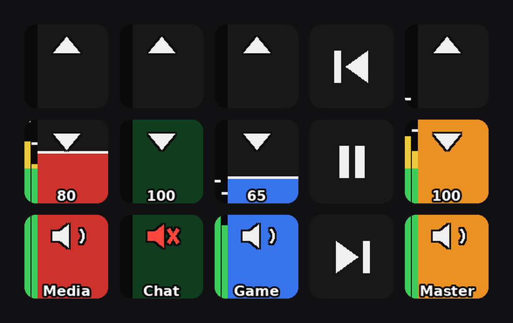

# Software mixer: PipeWire virtual channels + Stream Deck control surface

A software replacement for a Roland Bridge Cast: multiple virtual audio channels
("Media", "Chat", "Game") that mix into a physical output (Sound Blaster G3), with a
Stream Deck MK.2 as the physical control surface — colored per-channel fader columns
with volume up/down/mute keys, live stereo VU meters with peak-hold, 150% overdrive,
and MPRIS media-transport keys.

Built on Pop!_OS with PipeWire 1.6.8 / WirePlumber 0.5.12 and
[StreamController](https://github.com/StreamController/StreamController) 1.5.0-beta.16.



*(music on Media, Chat muted, Game quiet — rendered by the actual plugin code via
`docs/render_preview.py`)*

> This is my personal setup, published as-is in case it's useful — the sink names, deck
> serial, colors and layout are mine (see [Hardware assumptions](#hardware-assumptions-edit-if-they-change)),
> but every piece is plain config/Python and straightforward to adapt. The
> [gotchas section](#hard-won-gotchas-read-before-debugging) alone may save you hours
> if you're building anything similar.

## Architecture

```
apps (Steam, Spotify, Discord, ...)
  │  each app routed once via pavucontrol / GNOME sound settings;
  │  WirePlumber remembers the choice per application
  ▼
virtual sinks: media_channel / chat_channel / game_channel   (PipeWire loopbacks)
  │  per-channel volume = channel fader
  ▼
Sound Blaster G3 sink = master fader
```

The Stream Deck drives the sink volumes through StreamController with two plugins per
key: **Audio Control** (G4PLS, from the in-app store) does volume/mute, and
**FaderDisplay** (custom, in this repo) renders the visuals — each column of three keys
is one continuous vertical fader (bottom key 0–50%, middle 50–100%, top 100–150%),
filled in the channel color, dimmed to 35% brightness when muted, with chevron/mute
glyphs and per-row text.

## Repo layout

| Path | Installs to |
|---|---|
| `pipewire/10-virtual-channels.conf` | `~/.config/pipewire/pipewire.conf.d/` |
| `streamcontroller/pages/Mixer.json` | `~/.var/app/com.core447.StreamController/data/pages/` |
| `streamcontroller/settings/pages.json` | `~/.var/app/com.core447.StreamController/data/settings/` (maps deck serial → default page) |
| `streamcontroller/plugins/com_marc_FaderDisplay/` | `~/.var/app/com.core447.StreamController/data/plugins/` |

## Restore from scratch

```bash
./restore.sh
```

Then two manual steps:

1. In StreamController: ☰ menu → **Store** → install **Audio Control** (by G4PLS),
   then quit (tray → Quit) and relaunch.
2. Route each app to its channel once in `pavucontrol` (Playback tab) — WirePlumber
   remembers it from then on.

### Hardware assumptions (edit if they change)

- **G3 sink name** (appears in both the PipeWire conf and `Mixer.json`):
  `alsa_output.usb-Creative_Technology_Ltd_Sound_Blaster_G3_CC08F2F2C2F3E386-03.analog-stereo`
  — if the G3 is replaced, get the new name from `pactl list sinks short` and
  search/replace in both files.
- **Deck serial** `A00SA5182J7QBL` in `settings/pages.json` — a different deck needs
  its serial swapped in (shown in StreamController, or in its log on connect).
- No udev rule is needed for the Stream Deck: modern systemd ships uaccess rules for
  Elgato decks out of the box.

## How the pieces work

### PipeWire virtual channels

Each channel is a `libpipewire-module-loopback`: the capture side is a virtual sink
(`media_channel` etc.), the playback side is pinned to the G3 by `target.object`.
Because it's a user config fragment, it loads at every login — no service, no script.
Deliberate choices, commented in the conf:

- `node.dont-reconnect = true`: if the G3 is unplugged, channels go silent instead of
  failing over to another output (avoids misrouting and feedback loops).
- `node.passive = true`: channels suspend when idle.
- Adding a channel = copy a block, rename `node.description` + both `node.name`s, then
  `systemctl --user restart pipewire pipewire-pulse wireplumber`.

### Stream Deck page (`Mixer.json`)

Columns left→right: **Media (red) / Chat (green) / Game (blue) / media keys / Master (orange)**.
Fader rows top→bottom: **+10% (▲) / −10% (▼, shows volume) / mute (speaker, shows name)**.
The fourth column is media transport, top→bottom: **previous (⏮) / play-pause (⏯) / next (⏭)**
— these drive MPRIS (same as keyboard media keys) and the play/pause glyph tracks the live
playback state; glyphs dim grey when no media player is running.
Every fader key carries two actions: `com_gapls_AudioControl::AdjustVolume|Mute`
(index 0, the behavior) and `com_marc_FaderDisplay::Segment` (index 1, the visuals),
with `image-control-action: 1` and `label-control-actions: [1,1,1]`. Media keys carry a
single `com_marc_FaderDisplay::MediaKey` action with a `media-command` setting
(`play-pause`/`previous`/`next`).

Per-key `Segment` settings: `pulse-name`, `range-low`/`range-high` (this key's slice of
the fader), `color`, `glyph` (`up`/`down`/`mute`/`none`), `text`
(`none`/`volume`/`label`), `label`, `max-volume` (150 = overdrive full-scale),
`meter-target` (PipeWire node for the live VU strip; see below).

### Live VU meters

Each fader column carries a stereo peak meter on its left edge (L|R bars with
green/yellow/red dB zones and a peak-hold line): the three channels meter their
**effective output** (post-fader, post-mute — muted means a silent meter), and the
Master column meters the final G3 mix. Scale: -42 dBFS at the bottom, 0 dBFS on the
100%-volume line, +6 dB of overdrive headroom in the top third. Display runs at 15 Hz
with fast-attack/slow-release ballistics and a 1.2 s peak hold; only keys whose meter
pixels changed are redrawn (~1.6 ms each, ~10% of one core while audio plays, ~zero
when idle).

### FaderDisplay plugin

A few hundred lines of Python, two action types. **Segment**: one daemon thread holds a
`pulsectl` connection listening for sink events; on any volume/mute change it re-renders
every registered Segment (PIL-drawn 96×96 bitmaps). Volume text and labels are StreamController
labels, so they render with the app's font stack on top of the bitmap. **MediaKey**:
presses run `flatpak-spawn --host playerctl <play-pause|previous|next>` (the sandbox
can't talk to MPRIS bus names directly, but it may talk to the Flatpak portal, so host
commands work); a second daemon thread follows `playerctl --follow status` to repaint
the play/pause glyph on state changes. **Host dependency: `playerctl`**
(`sudo apt install playerctl`).

**Metering** holds one capture pipe per metered node (8 kHz stereo f32, ~64 KB/s each):
`flatpak-spawn --host pw-record --target <channel>.out` for the channels and
`flatpak-spawn --host parec --device=<G3>.monitor` for the master. A reader thread per
pipe accumulates stereo peaks; one display thread applies ballistics, maps amplitude to
the fader scale (cubic-volume dB math in `_amp_to_frac`), and re-renders only keys
whose quantized meter pixels changed.

## Hard-won gotchas (read before debugging)

- **Pages created outside the GUI render black**: every key state needs
  `"label-control-actions": [i,i,i]` and `"image-control-action": i` (action index
  that may draw). Without them actions *work* but paint nothing. The GUI writes these
  automatically; hand-written JSON must include them.
- **Never `flatpak kill` StreamController**: an unclean exit wedges the deck's HID
  ("Failed to read feature report") and it stays invisible until a USB reset or
  replug. Quit via the tray menu, or DBus:
  `gdbus call --session --dest com.core447.StreamController --object-path /com/core447/StreamController --method org.gtk.Actions.Activate quit "[]" "{}"`
- **Plugin manifests must include a `github` field** (any URL). Without it
  `register()` silently fails and the plugin's actions are "not found" even though the
  plugin imported fine.
- **Hot-reloading a page** (no app restart): the DBus API — `RemovePage` + `AddPage`
  (full JSON) + `ChangePage`. `ChangePage` alone is a no-op if the page is already
  active. Plugin *code* changes do need a quit/relaunch.
- **Testing without touching the deck**: `EmulateInput "press" <serial> <page> "x,y"`
  over DBus fires the full action pipeline; coordinates are `"col,row"` from top-left.
- **Virtual-sink monitors are silent on this PipeWire (1.6.8)**: recording from the
  `.monitor` of a loopback or null sink yields all-zero samples even while audio flows
  through it (hardware sink monitors work fine). Meter taps must use the loopback's
  *output stream node* (`<channel>.out`) via `pw-record --target` instead. Conversely,
  `pw-record` can't tap a hardware sink's monitor (also silent) — use `parec` for those.
  Post-fader either way: a muted channel meters as silence.
- **Key presses reach actions via `EventAssigner`s, and the core never calls
  `create_event_assigners()`** — that's a plugin convention (AudioControl calls it from
  its own base `__init__`). Register assigners from your action's `__init__`
  (`add_event_assigner` with `default_events=[Input.Key.Events.DOWN]`); there is no
  `on_key_down` hook and a missing assigner fails silently.
- **`flatpak-spawn --host` replays the sandbox's cwd on the host**, and the app runs
  from `/app/bin/StreamController`, which doesn't exist there — every spawn dies with
  "Failed to change to directory". Always pass `cwd="/"` to `subprocess`.
- The deck's USB can be reset in software if it ever wedges:
  `python3 -c "import fcntl,os; fd=os.open('/dev/bus/usb/BUS/DEV', os.O_WRONLY); fcntl.ioctl(fd, 21780, 0)"`
  (find BUS/DEV via `lsusb | grep 0fd9`; works because systemd grants the console user
  access to Elgato devices).

## License

[MIT](LICENSE).
