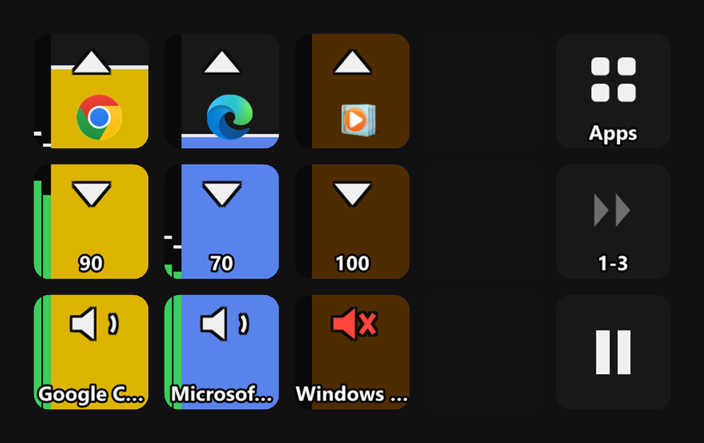
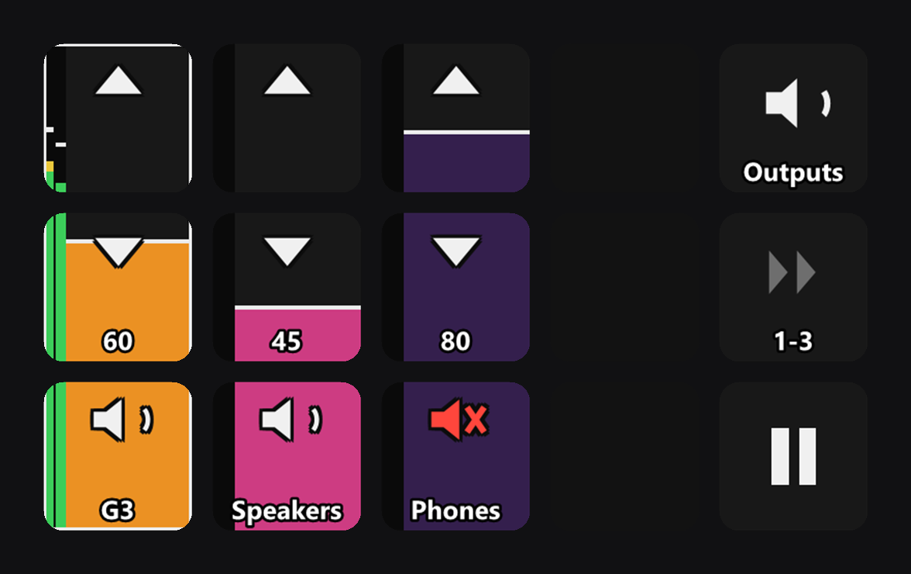
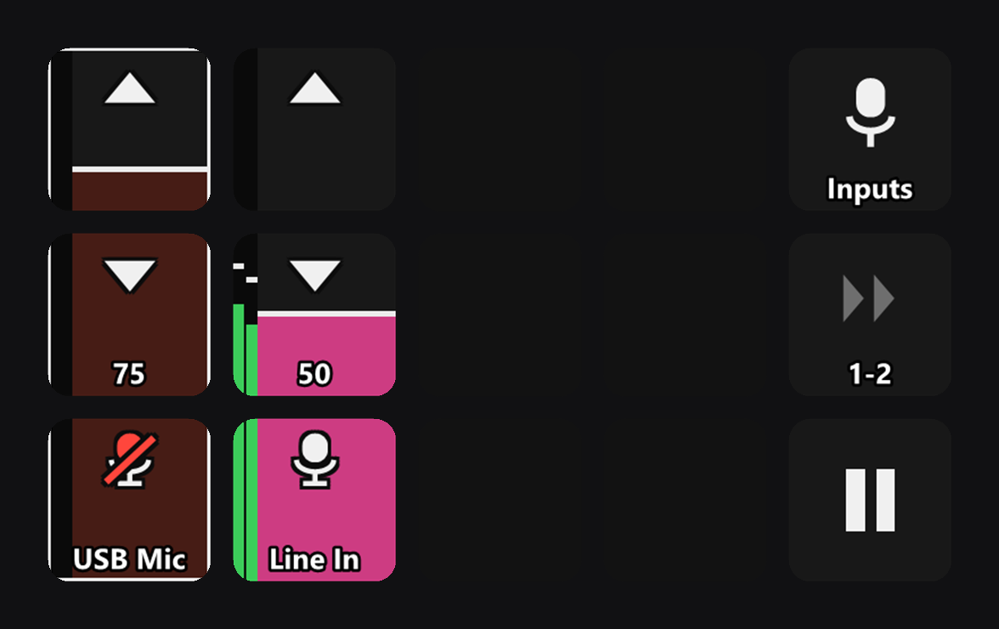

# Windows: Stream Deck plugin with per-app faders

The Windows counterpart of the [Linux mixer](../linux/README.md): the same colored
fader columns, VU meters, page-mode key and play/pause key, as a plugin for Elgato's own
Stream Deck app. Built for a Stream Deck MK.2 (5×3).

*(Rendered by the plugin's own drawing code via `FaderDisplay.exe --preview docs`.)*

## What's different from Linux

- **No virtual channels.** Windows can't create audio devices without a driver, and
  per-application control covers the same need: route each app to a device once in
  *Settings → System → Sound → Volume mixer* (Windows remembers it), then ride its fader
  on the **Apps** page. So there are three pages: **Apps → Outputs → Inputs**.
- **Volume tops out at 100%** (Windows has no overdrive), so the three keys of a column
  are 0–33 / 33–67 / 67–100%, and the meter puts 0 dBFS at the top of the column
  (-42 dBFS at the bottom; green below -12 dB, yellow to -3 dB, red above).
- **One action for every key.** Elgato's app has no per-page JSON to write, so the plugin
  works out each key's role from where it sits: every column except the last is a fader
  column (▲ volume up / ▼ volume down with the level / mute with the name), and the last
  column is page-mode (top), pager (middle) and play/pause (bottom). Paging between Apps,
  Outputs and Inputs happens inside the plugin, so a single Stream Deck profile page holds
  the whole mixer.

## Install

1. Install the [Stream Deck app](https://www.elgato.com/downloads) (6.4 or later) and
   the [.NET 10 SDK](https://dotnet.microsoft.com/download).
2. Run `./install.ps1` in PowerShell. It builds the plugin, quits the Stream Deck app,
   copies the plugin to `%APPDATA%\Elgato\StreamDeck\Plugins\com.marc.faderdisplay.sdPlugin`
   and starts the app again. Safe to re-run after changes.
3. In the Stream Deck app, drag **Mixer Key** (category *FaderDisplay*) onto all 15 keys
   of a profile.

## Repo layout

| Path | What |
|---|---|
| `src/FaderDisplay/` | the plugin (C#, .NET 10; NAudio for Core Audio) |
| `com.marc.faderdisplay.sdPlugin/` | the plugin bundle: `manifest.json` + icons; `install.ps1` publishes the exe into its `bin/` |
| `fader-display.example.json` | example of the optional config file |
| `install.ps1` | build + install |

## Pages

- **Apps**: every application with an audio session, the same list as Windows' own
  volume mixer (running processes, system sounds excluded). An app's sessions on every
  output device are grouped into one column, labelled with the session's display name
  or the exe's file description ("Google Chrome"). Each app keeps a stable color (hashed
  from its name, with the same palette and hash as on Linux) and a stable column order
  (first seen). The top key shows the exe's icon, as Explorer shows it.
- **Outputs**: every active playback device, the **default device first** with an
  accent ring and the "master" color.
- **Inputs**: every active recording device, the default first and ringed, with a
  mic-glyph mute key (red and slashed when muted).

More columns than fit means the pager pages through them, four at a time on an MK.2.
Labels default to the device's short name as Sound settings shows it ("Speakers" from
"Speakers (Sound Blaster G3)"); rename the device there, or use the config file, to
change it. Where two devices share a short name the full name is used instead.

## Config (optional)

`%APPDATA%\FaderDisplay\fader-display.json` sets order, labels and colors for devices;
see [`fader-display.example.json`](fader-display.example.json). `match` takes a
device's full name, its short name or its endpoint ID. Listed devices come straight
after the default device, in the order given; `master.color` applies to whichever output
is default. Changes apply within a second, with no restart needed. Delete the file to go
back to automatic.

## How it works

One worker thread owns everything (Core Audio objects, key state, rendering), so there's
no locking:

- every 500 ms it re-enumerates devices and sessions and re-reads volumes, mute and
  media state. Polling is cheap, and it means no COM callbacks to marshal;
- every ~30 ms it reads the peak meters of the columns on screen. Core Audio keeps a
  peak meter on every endpoint and session (`IAudioMeterInformation`), so unlike Linux
  there are no capture streams for outputs or apps;
- 15 times a second it rebuilds every key's `KeyVisual` (a value record of everything
  the image depends on, with meter levels quantized to 2 px) and sends a PNG
  (`setImage`) only for keys whose visual changed.

Key presses and Stream Deck events are queued to that thread and acted on immediately.
Volume and mute go through `IAudioEndpointVolume` (devices) and `ISimpleAudioVolume`
(each of an app's sessions). Play/pause uses Windows' system media transport controls,
the session the keyboard media keys drive; the glyph dims when no player is active.
Muted columns meter as silence, as on Linux.

Images are 144×144 (Elgato's @2x size), drawn with System.Drawing on the same 96-unit
canvas as the Linux PIL code so the geometry ports one-to-one. Captions are drawn into
the bitmap rather than set as Stream Deck titles. Logs go to
`%APPDATA%\FaderDisplay\plugin.log`.

### Developer modes

Run from a terminal (after `dotnet build -c Release`, the exe is in
`src/FaderDisplay/bin/Release/net10.0-windows10.0.19041.0/win-x64/`):

- `FaderDisplay.exe --probe` lists the devices, apps and media state the plugin sees,
  then prints two seconds of live meter readings.
- `FaderDisplay.exe --harness <dir> [col,row ...]` stands in for the Stream Deck app: it
  launches the plugin over a local WebSocket, shows it a 5×3 deck, steps through the
  three pages and saves what the keys showed as `harness-*.png`. Any `col,row` presses
  are made on the Apps page first. **They really change volumes.**
- `FaderDisplay.exe --preview <dir>` renders the staged scenes above.

## Gotchas

- **Input meters need a capture stream.** A recording device's peak meter reads zero
  unless something is capturing from it. While the Inputs page is showing, the plugin
  opens a discard-everything capture on the **default input only**, so Windows shows
  the microphone as in use. Other inputs meter whenever another app is recording from them.
- **Some interfaces allow only one capture at a time.** On the Sound Blaster G3,
  opening a second capture on any of its inputs fails with `AUDCLNT_E_DEVICE_IN_USE`
  (0x8889000A). That's why only the default input is captured: capturing them all
  could lock the microphone away from a chat app.
- **The plugin is a `WinExe`**, so the Stream Deck app launches it without a console
  window. The developer modes attach to the parent terminal's console to print.
